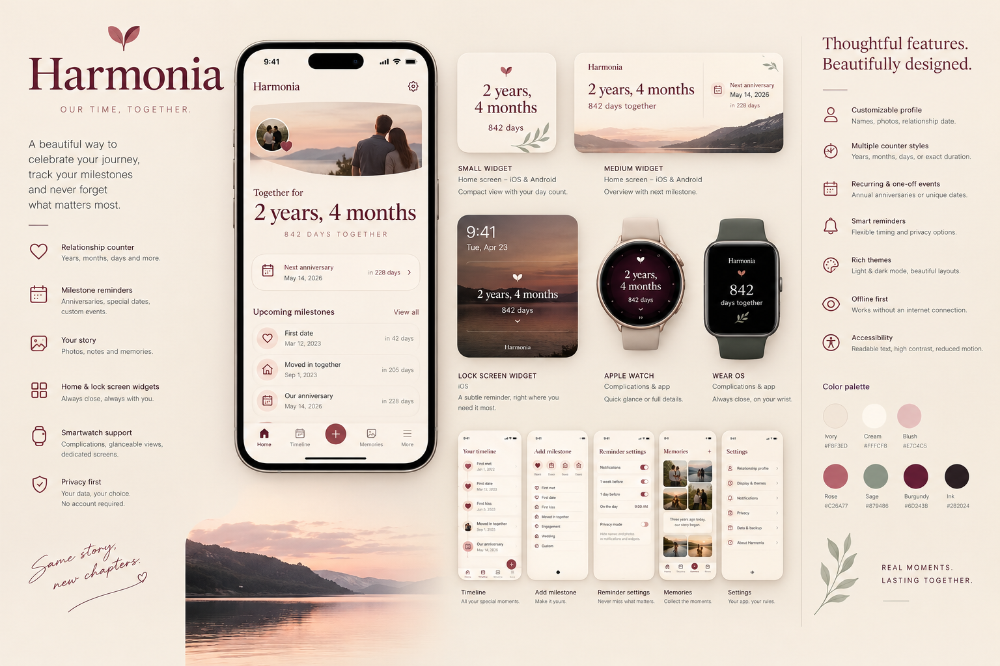
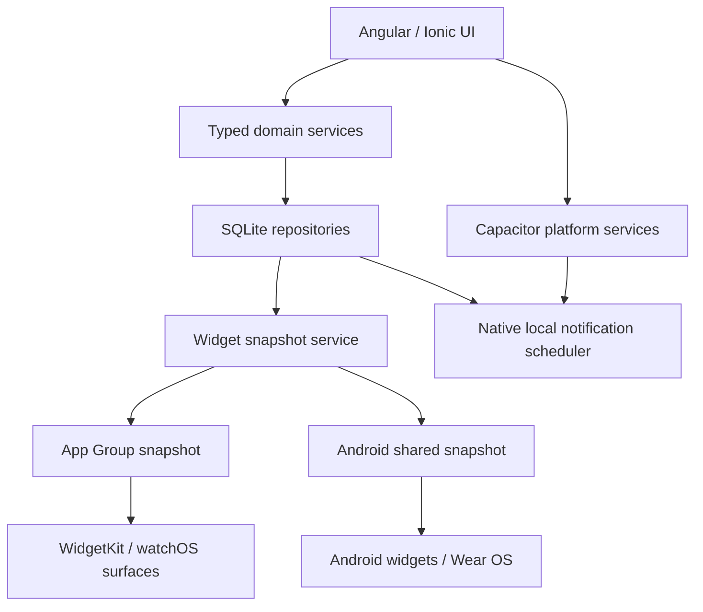

# Harmonia — Product & Engineering Specification

> **Purpose:** This is the source of truth for building the Harmonia relationship companion app with Claude Code. Read this document completely, then execute the project in small, testable phases. Do not stop after producing a plan.
>
> **Working name:** Harmonia  
> **Tagline:** *Our time, together.*  
> **Product type:** Local-first relationship counter, milestone tracker, memory journal, reminders, widgets, and smartwatch companion.  
> **Platforms:** Android and iOS, with native widgets and watch capabilities for Wear OS and watchOS.  
> **Initial architecture:** Ionic + Angular + Capacitor for the main app; native Swift/SwiftUI and Kotlin integrations for system widgets and watch experiences.  
> **Backend:** None for the initial release.

---

## 0. Mandatory execution instructions for Claude Code

These instructions take precedence over convenience or default conversational behaviour.

1. **Do not ask routine clarification questions.** The product decisions and defaults are specified below. Make reasonable engineering decisions where a minor detail is unspecified, document the decision, and continue. Ask the user only if a genuine external authorization, paid service, secret credential, or destructive action is unavoidable. Do not use questions as a substitute for implementation.
2. **Execute, do not only advise.** Inspect the repository, establish the current state, write the implementation plan to the repository, and start building immediately. Do not stop after generating documents, wireframes, or a plan.
3. **Inspect before changing.** If the repository contains an existing project, preserve its conventions and unrelated work. Never overwrite user changes or reset the repository. If the directory is empty, scaffold the project using this specification.
4. **Keep the app runnable.** Work in vertical slices. After each phase, run the available tests, lint, type-check and build commands. Fix regressions before moving on. Do not leave the app in a broken intermediate state at the end of a work session.
5. **Continue around environment blockers.** If this environment cannot build or sign an iOS target because macOS/Xcode is unavailable, continue with all work that can be completed, create the required native source/configuration where feasible, validate everything available on the current platform, and clearly document the exact remaining verification step. Do not claim an unexecuted build passed and do not stop unrelated work because one platform cannot be built here.
6. **Verify current platform requirements.** Use current official Android, Apple, Angular, Ionic and Capacitor documentation when APIs or plugin compatibility may have changed. Prefer stable, maintained releases compatible with the installed toolchain. Do not blindly install `latest` if it introduces an incompatible major version.
7. **Avoid unnecessary architecture.** No account system, server, cloud database, social feed, chat, generative AI, or analytics is needed for the first release. Do not add these to “prepare for the future.” Provide clean extension points only where required by the specified platforms.
8. **Native widgets and watches are real requirements.** Do not pretend an Angular web view can render a native home-screen widget, Apple Watch complication, or Wear OS complication. Implement them through platform-supported native targets and data-sharing bridges.
9. **Track progress in the repository.** Maintain `docs/IMPLEMENTATION_PLAN.md` with completed work, test/build results, blockers, and the next concrete task. Update it as phases progress. Do not ask the user whether to continue between phases; continue until all feasible scope is complete.
10. **Do not fake capabilities.** Widgets and complications are controlled by operating-system refresh policies and cannot be guaranteed to tick every second. State and implement realistic refresh behaviour. If a desired feature is not supported by the selected OS/API, provide the closest supported alternative and document the limitation.
11. **Finish features end-to-end.** A screen is not complete if its actions are decorative. Inputs must persist, validation must work, routes must open, reminder settings must affect actual notification schedules, and widget configurations must influence their output.
12. **Deliver maintainable code.** Use typed domain models, isolated date logic, database migrations, testable services, accessible UI components, and clear naming. Avoid giant components and monolithic services.

### Required initial repository outputs

Create or update the following as appropriate:

- `CLAUDE.md` — concise standing project instructions referring to this specification.
- `docs/PRODUCT_SPEC.md` — copy this specification into the repository or link to the source document.
- `docs/ARCHITECTURE.md` — architecture, boundaries, native bridges, data flow, and decisions.
- `docs/IMPLEMENTATION_PLAN.md` — phased checklist with build/test status and blockers.
- `docs/DATE_AND_TIME_RULES.md` — date semantics and edge cases from section 8, with test examples.
- `README.md` — setup, development, test, build, and platform-specific instructions.

If the source document is already located in the repository, do not duplicate it unnecessarily; keep the repository copy authoritative and maintain it as work evolves.

---

## 1. Product vision

### 1.1 One-sentence description

Harmonia is a beautiful, private relationship companion that shows how long two people have been together, preserves important moments, and gently reminds them of milestones—on their phone, home screen, lock screen, and smartwatch.

### 1.2 Product promise

**A daily reminder of a relationship, not merely a counter of its duration.**

The relationship counter is the core feature. The product becomes worth keeping because it combines a glanceable live duration, meaningful dates, thoughtful reminders, a personal timeline, and well-designed widgets and watch surfaces.

### 1.3 Audience

- People in a romantic relationship who want to mark the time they have spent together.
- Couples who care about anniversaries and small shared milestones.
- People who prefer an intimate, personal app over a social network or generic calendar.
- Users who value privacy and want the app to work offline without creating an account.

The app must support different relationship types and genders without assumptions. Avoid heteronormative wording or fixed labels such as “boyfriend” and “girlfriend.” Use neutral default copy such as “partner,” “together,” and “your story,” while allowing the user to customize names and labels.

### 1.4 Core product principles

1. **Personal, never performative.** The app is primarily for the user and their partner, not for public posting.
2. **Elegant restraint.** Warm and romantic, but not childish, cluttered, or saturated with hearts.
3. **Useful at a glance.** The home screen, widgets, and watch surfaces should answer the main question without opening the app.
4. **Private by default.** Store relationship data locally. Do not require accounts, network access, tracking, or analytics.
5. **Reliable dates matter.** Date and time correctness is more important than animation or decoration.
6. **Native where it counts.** Widgets, notifications, and watch experiences must respect platform conventions.
7. **No guilt or gamification.** Do not use streaks, scores, engagement pressure, or notifications intended merely to pull people back into the app.

### 1.5 Explicit non-goals for the initial product

Do not build these unless a later request changes the scope:

- Dating, matchmaking, or public profiles.
- Social feeds, followers, likes, comments, or messaging.
- Required sign-in or partner account linking.
- Cloud backend, remote database, or server-side notification service.
- AI-generated relationship advice or generated memories.
- Public sharing by default.
- Calendar write access or contact access.
- Location, health, or behavioural tracking.
- Ads, ad SDKs, or third-party analytics.
- A generic task manager or full gift-shopping service.

A later version may add opt-in private synchronization or couple sharing, but the first release must be excellent without it.

---

## 2. Name and brand direction

### 2.1 Working name: Harmonia

Use **Harmonia** as the project and in-app working name during implementation. The tagline is **“Our time, together.”**

Harmonia is associated in Greek mythology with harmony and concord and is linked with marital union. That makes it a fitting metaphor for two lives moving together over time. The mythological reference should be subtle: use the name and a refined visual identity, not literal Greek columns, gods, temples, or fantasy illustrations.

### 2.2 Naming caution

The name is a working title, not a claim of trademark, domain, or app-store availability. Searches indicate that “Harmonia” is already used by unrelated apps and products, so a pre-release naming review remains necessary. “Anteros” is thematically excellent because it is associated with returned or requited love, but it is already used by an active dating app; do not silently switch the app to that name. Keep the display-name, bundle/package identifiers, domain, and store listing strings centralized so the branding can be changed without a code-wide rename.

At the point of public release, check trademark databases and current Apple App Store, Google Play, domain, and social handle availability. Do not claim legal clearance based only on a web search.

### 2.3 Brand voice

- Warm, intimate, calm, and sincere.
- Confident and minimal rather than flowery.
- Short copy that sounds human.
- Avoid clichés such as “soulmate forever” unless the user writes their own text.
- Prefer “Your story,” “Together since,” “A little more every day,” and “Your next milestone.”

### 2.4 Icon direction

Create a minimal, recognizable app icon that works at small sizes:

- A refined interlocking pair of curved lines or a continuous loop suggesting two lives joined.
- Optional small negative-space heart, but no generic glossy heart sticker.
- Deep berry or muted burgundy background with an ivory/soft-rose mark.
- Flat or very subtly dimensional; no text in the icon.
- Provide light/dark and platform-appropriate variants if needed.
- Use original artwork or properly licensed assets only.

---

## 3. Visual design system

### 3.1 Overall art direction

Premium editorial minimalism: warm ivory surfaces, muted rose accents, deep burgundy typography, generous spacing, refined serif headlines, a highly readable sans-serif UI font, delicate lines, and restrained motion. The app should feel like a personal keepsake or beautifully designed journal.



> **Visual reference only:** This moodboard communicates the intended art direction and breadth of surfaces. Treat any small text, dates, and sample counter values inside the illustration as placeholders, not product data or exact UI copy. Follow the written requirements and accessibility rules below when implementing the actual app.

The UI should not look like a generic productivity dashboard. Use a quiet hierarchy: one emotionally meaningful counter, one upcoming milestone, and a small number of supporting actions.

### 3.2 Color tokens

Define these as named design tokens instead of scattering hex values through components. Treat the values below as the initial palette; check contrast and adjust where accessibility requires it.

| Token | Light theme | Purpose |
|---|---|---|
| `canvas` | `#F8F3ED` | Main warm ivory background |
| `surface` | `#FFFCF8` | Cards, sheets, form surfaces |
| `surface-muted` | `#F0E7E2` | Secondary backgrounds and widget panels |
| `ink` | `#2B2024` | Primary text |
| `ink-muted` | `#76676B` | Supporting text |
| `berry` | `#6D243B` | Primary brand/action color |
| `rose` | `#C26A77` | Highlight accents and selected states |
| `rose-soft` | `#E7C4C5` | Decorative emphasis, never small low-contrast text |
| `line` | `#E3D8D3` | Borders and separators |
| `sage` | `#879486` | Restrained positive/secondary accent |
| `danger` | `#B33C4A` | Errors and destructive actions |

| Token | Dark theme | Purpose |
|---|---|---|
| `canvas` | `#171315` | Main background |
| `surface` | `#242023` | Cards and sheets |
| `surface-muted` | `#30282D` | Secondary panels |
| `ink` | `#F5EEEC` | Primary text |
| `ink-muted` | `#C0B0B3` | Supporting text |
| `berry` | `#D18A9A` | Primary action/highlight |
| `rose` | `#E0A1AC` | Emphasis |
| `line` | `#44383E` | Borders and separators |
| `sage` | `#A7B49F` | Restrained secondary accent |
| `danger` | `#FF8A94` | Errors and destructive actions |

Do not rely on color alone to communicate state. Check text, controls, icons, borders, and focus states for accessible contrast in both themes.

### 3.3 Typography

- Display/hero headings: a refined, readable serif such as Fraunces or a comparable licensed font.
- Body, navigation, controls, dates, and accessibility labels: a neutral sans-serif such as DM Sans or a comparable licensed font.
- Use a system fallback stack if custom font assets cannot be bundled reliably.
- Bundle fonts locally; do not fetch fonts at runtime. Verify licenses and include required license notices.
- Numerals in the main counter must be clear and stable. Use tabular numerals when supported to prevent visual jitter.
- Do not use a script font for essential information.

### 3.4 Spacing, shape, and elevation

- Use a consistent 4-point spacing scale.
- Standard page horizontal inset: approximately 20–24 dp/pt, adapting to device size and safe areas.
- Cards: 18–24 dp/pt radius; buttons and chips use a consistent, smaller radius or pill treatment based on component type.
- Borders are thin and low contrast; shadows are rare and soft.
- Avoid stacking many nested cards. Use whitespace to separate content.
- Respect safe areas, keyboard insets, dynamic type, and large font settings.

### 3.5 Motion

- Use short fades, gentle crossfades, and small scale/opacity transitions when changing milestone states.
- A milestone celebration may use a restrained burst of small particles or a gentle glow. Do not make the app feel like a game.
- No continuous background animation.
- Respect reduced-motion accessibility settings and provide a static alternative.
- The counter should never animate every second in a way that drains battery or causes visual distraction.

### 3.6 Imagery

- Let the user optionally choose one partner/couple photo for the relationship profile and optional photos for memories.
- Photos should be framed elegantly, not covered by stickers or filters.
- The app must still look complete without a photo.
- Never require a photo or request photo permission at first launch. Use the platform photo picker when possible to avoid broad library access.
- Do not download stock photos at runtime. Use neutral placeholders and original decorative shapes where no user image exists.

### 3.7 Core component style

Implement reusable components for:

- Main relationship counter.
- “Next milestone” card.
- Milestone list row and timeline entry.
- Date/time editor.
- Reminder offset selector.
- Photo/avatar surface.
- Empty state.
- Confirmation and destructive-action dialog.
- Theme and widget-preview controls.

Buttons must have clear pressed, disabled, focus, and loading states. Form errors should be close to the field and announced accessibly.

---

## 4. Information architecture and screen requirements

### 4.1 Primary navigation

Use a simple bottom navigation with four sections:

1. **Home** — counter, upcoming milestone, recent story highlights.
2. **Timeline** — past milestones and memories in chronological order.
3. **Dates** — all milestones, upcoming dates, recurrence and reminder settings.
4. **Memories** — saved memory notes and photos.

Settings and relationship-profile editing are reached through a small profile/settings action in the Home header. Keep navigation shallow. Avoid a fifth primary destination just for settings.

### 4.2 First launch and onboarding

Goal: the user should reach a useful counter in under a minute, without being forced to create an account or grant permissions.

Flow:

1. A calm welcome screen with the product name and tagline.
2. Ask for the relationship start date (required).
3. Allow an optional start time; explain that it enables a more precise elapsed-time view but is not required.
4. Ask for partner name/nickname (optional) and optional photo.
5. Ask whether to create a first milestone/reminder (optional). Offer sensible default examples without silently creating fake personal events.
6. Create the relationship profile and enter Home.
7. Ask for notification permission only when the user turns on a reminder or completes a flow that clearly explains why notifications are needed. Never request it merely on first launch.

Requirements:

- Provide a skip option for every optional field.
- Support editing all onboarding values later.
- Validate impossible dates and future relationship start dates. If a future start date is allowed for a pre-relationship countdown, make that an explicit mode and do not silently accept it as an elapsed relationship.
- Never ask for account creation.
- No lengthy tutorial carousel.

### 4.3 Home screen

The Home screen is the emotional center of the app.

Hierarchy:

1. Small greeting/header and settings/profile affordance.
2. Optional relationship photo or minimal decorative emblem.
3. Main duration, such as “2 years, 4 months” with “842 days together” underneath. These are illustrative values, not hard-coded content.
4. A quiet label such as “Together since 14 June 2024.”
5. The next upcoming milestone with date and remaining days.
6. A concise “Your story” area showing one or two recent/pinned milestones.
7. A restrained quick action to add a milestone or memory.

Behaviour:

- Main counter is calculated from persisted relationship data and the current date/time; never stored as an incremented counter.
- If no future milestones exist, show a helpful, warm empty state with a single “Add an important date” action.
- If no memories exist, the Home screen remains attractive and uncluttered.
- Do not place ads, promotions, premium paywalls, or unrelated suggestions here.
- Home must be usable offline and after a fresh cold start.

Suggested structure (text wireframe, not literal final styling):

```text
┌──────────────────────────────────┐
│  Harmonia                    ⚙   │
│                                  │
│          [optional photo]        │
│                                  │
│       2 years, 4 months           │
│          842 days together        │
│       Together since 14 June      │
│                                  │
│  YOUR NEXT MOMENT                 │
│  Anniversary                 12d  │
│  Saturday, 14 June                │
│                                  │
│  YOUR STORY                       │
│  First trip                 2024  │
│  Moved in together          2025  │
│                                  │
│  Home   Timeline   Dates   Memories│
└──────────────────────────────────┘
```

### 4.4 Counter modes

Provide these formats in the app:

- **Calendar duration:** years, months, and remaining days.
- **Total days:** primary total elapsed calendar days.
- **Weeks and days:** optional secondary format.
- **Precise duration:** optional hours/minutes and, on the detail view only, seconds if a start time was entered.

Rules:

- Calendar duration is the default hero presentation.
- Total days is always available.
- Do not show an exact hours/minutes/seconds count when the user supplied only a date, since pretending to know an exact time would be misleading.
- If seconds are shown, update only while the relevant screen is visible and avoid unnecessarily frequent change detection. Pause or reduce work when the app is backgrounded.
- Widgets and watch complications should prioritize total days or a short calendar duration, not a second-by-second clock.

### 4.5 Timeline screen

- Show milestones and memory entries chronologically.
- Default order is oldest to newest for the narrative timeline, with a clear way to jump to “Latest.” If this makes scanning difficult, provide an explicit reverse-chronological toggle while preserving a consistent default.
- Distinguish past events, today, and future milestones visually and with text, not color alone.
- Tapping an entry opens its detail page.
- Allow edit, pin/unpin, add note/photo, and delete with confirmation.
- Empty state explains that important moments will appear here as the user adds them.

### 4.6 Dates screen

- List upcoming milestones first, then past dates in a separate collapsible section.
- Provide list and calendar-style views only if both can be implemented accessibly and maintained; prioritize the clear list view for MVP.
- Each date row shows title, formatted date, countdown or elapsed duration where applicable, recurrence indicator, and reminder status.
- Filters: All, Upcoming, Past, Annual. Do not overcomplicate with arbitrary tags in the first release.
- Add/edit form must support one-off and annual recurrence.

### 4.7 Create/edit milestone

Fields:

- Title (required).
- Type/category (predefined or Custom).
- Date (required).
- Optional time.
- Recurrence: none or yearly.
- Reminder(s): disabled by default; if enabled, allow one or more offsets.
- Optional note.
- Optional photo attachment.
- Optional “Pin to Home” setting.

Preset milestone categories:

- We met.
- First date.
- We became a couple.
- First kiss.
- First trip together.
- Moved in together.
- Engagement.
- Wedding.
- A custom moment.

Presets are suggestions, not required steps. The user can rename, omit, or add any milestone. Do not assume every relationship follows these stages.

Validation:

- Title cannot be blank or only whitespace.
- Date must be a real calendar date.
- Optional time must be valid.
- Prevent duplicated scheduled notification records when a milestone is edited.
- Confirm before deleting an entry that has attached memories; offer an explicit way to keep the memories without the milestone if the data model permits it.

### 4.8 Memories screen and memory editor

A memory is a short note and/or a collection of locally stored photos associated with a date or milestone. It is not a social post.

Requirements:

- Create a memory with a title (optional), body text (optional if photos are attached), date, and optional images.
- Optionally link a memory to a milestone; standalone memories are allowed.
- Store photos in the app's private file storage and save file references in the database, not large image blobs in SQLite.
- Preserve image orientation and generate appropriately sized thumbnails.
- Support editing and deleting memory entries.
- Export must include memory metadata and referenced media where feasible.
- Do not upload photos or notes.

### 4.9 Settings and profile

Sections:

**Relationship profile**
- Edit start date, optional start time, partner display name/nickname, photo, and relationship label.
- Make it clear that changing the start date recalculates all duration values but does not rewrite independent milestone dates.

**Appearance**
- Theme: System, Light, Dark.
- Theme accent or theme presets if the implementation can keep contrast accessible.
- Counter display preference.
- Widget privacy preferences.

**Reminders**
- Global enable/disable.
- Default reminder time.
- Default reminder offsets.
- Local calendar/timezone preferences where relevant.
- Rebuild/reschedule reminders action for recovery and troubleshooting.

**Privacy and data**
- Export data.
- Delete all local data with a clear warning and confirmation.
- Explain in plain language that data is stored locally and is not synced to an account.

**About**
- App version, acknowledgements and license notices.

Do not add a login or a cloud-sync toggle that does not work.

---

## 5. Widgets and glanceable surfaces

### 5.1 Design goal

Widgets are a first-class part of the product, not a later decorative extra. They should make the main value visible without opening the app and remain attractive when no photograph has been selected.

Native system widgets are snapshots/timeline-driven surfaces, not continuously running app views. Do not promise a second-by-second live counter outside the foreground app. Calculate or render the current date-derived value whenever the platform renders/refreshed the widget, and explicitly respect each OS's refresh policies.

### 5.2 iOS widgets

Implement:

1. **Small Home Screen widget** — total days together, subtle brand mark, optional short label.
2. **Medium Home Screen widget** — calendar duration or total days plus next milestone and countdown.
3. **Lock Screen accessory widget(s)** — compact numeric counter or milestone countdown; use platform-supported WidgetKit accessory families.
4. **Widget configuration** — allow supported user choices such as counter style, display label, and whether partner name/photo is shown. Use App Intents/configuration APIs appropriate to the deployment target.

Design rules:

- Read data from a documented App Group/shared container or another current, supported native bridge.
- Show a sensible placeholder and privacy-safe snapshot when data is unavailable.
- Deep-link to the relevant screen when tapped.
- Refresh/request timeline reload after the user changes dates, the profile, theme settings, or widget preferences. Do not spam refresh requests.
- Build a timeline with reasonable future entries for predictable date changes when useful. System-controlled refresh may occur later than requested; do not assume exact execution times.
- Observe `WidgetKit` constraints and budgets. The app must still be correct even if the widget cannot refresh at the exact midnight boundary.

### 5.3 Android home screen widgets

Implement:

1. **Small widget** — total days and minimal decorative mark.
2. **Medium widget** — counter plus next milestone/countdown.
3. **Widget configuration** where supported — counter mode and privacy/display options.

Requirements:

- Use the platform-supported native app widget framework, layouts, and update mechanisms compatible with the chosen Android minimum SDK.
- Persist the widget snapshot through an explicit native data-sharing contract. Do not depend on a running WebView.
- Update widget data when the app writes relevant changes and request an update using supported APIs.
- Handle process death, reboot, missing data, theme changes, locale changes, and date boundary updates appropriately.
- Do not request exact-alarm access just to keep a day counter current. Prefer OS-supported refresh mechanisms.
- Widget taps should deep-link to Home or the relevant milestone.

### 5.4 Shared widget content contract

Define and document a small versioned payload shared between the app and native widgets. It should include only what the widgets need, for example:

- Schema version.
- Profile display name only if the user allows it.
- Relationship start date, optional time, and relevant timezone identifier.
- Preferred counter mode.
- Next milestone title/date/countdown if permitted by privacy settings.
- Selected theme/appearance hints.
- Widget privacy mode.
- Data-updated timestamp.

Do not copy the full SQLite database into widget storage. Do not place personal notes, raw photo collections, or unnecessary identifiers in widget snapshots. Handle schema version changes safely.

### 5.5 Widget privacy

Settings must allow the user to choose a discreet widget mode:

- **Normal:** counter plus permitted name/milestone details.
- **Discreet:** number and brand mark only, no name or milestone title.
- **Minimal:** only the day count or a neutral icon if the platform's minimum widget size requires it.

Changing privacy settings must trigger widget refresh requests. When the app is locked or data is unavailable, prefer the privacy-safe representation.

---

## 6. Smartwatch experiences

Watch support is part of the product target. Implement a focused experience rather than copying the entire phone UI to a small screen.

### 6.1 Apple Watch / watchOS

**First priority: WidgetKit complications and Smart Stack widget.**

Provide supported complication layouts where the selected watchOS APIs and complication families permit:

- Circular/compact numeric form: day count.
- Rectangular form: short relationship duration or next milestone.
- Inline form: concise day count or countdown.

Create a small native watchOS companion screen containing:

- Main duration.
- Total days together.
- Next milestone and days remaining, when one exists.
- A simple action to open the corresponding information on the phone where direct editing is unsuitable.

Use SwiftUI and current WidgetKit watch complication support for supported deployment targets. Share only the minimum needed data with the watch and treat it as a cached snapshot. Use WatchConnectivity only where needed and supported; this is not a cloud-sync system.

### 6.2 Wear OS

**First priority: watch-face complication and a glanceable surface.**

Provide:

- A short-text or numeric complication for total days.
- A longer-text complication for the calendar duration or next milestone.
- A small native Wear OS screen showing the duration, total days, and next milestone.
- A tile only if it provides a clear additional use beyond the complication and can be maintained without needless complexity.

Use current official Wear OS complication APIs and recommended integration patterns. Use the Wearable Data Layer when it is the appropriate supported method for phone-to-watch data transfer; do not invent a proprietary network protocol.

### 6.3 Watch interaction and limitations

- The watch experience is primarily glanceable; full milestone editing remains on the phone in the initial release.
- Watch surfaces must handle stale/missing snapshots gracefully.
- Complications must not require network access.
- Do not attempt constant background synchronization. Transfer updates when data changes and use platform-supported refresh opportunities.
- If a specific watch face/family cannot display the intended content, degrade gracefully to total days and a small app identifier.
- Document the exact minimum supported OS versions after checking current official requirements and actual plugin/toolchain support.

---

## 7. Reminders and local notifications

### 7.1 Default approach

Use local notifications only. No server, push notification service, or network connection should be necessary to remind the user about a saved date.

### 7.2 Reminder options

For each milestone, allow the user to choose one or more reminder offsets:

- On the day.
- 1 day before.
- 3 days before.
- 7 days before.
- A custom number of days before, if supported cleanly by the UI.

Allow a preferred time of day, defaulting to **09:00 local time**. The user can change the default in settings and override it per milestone if desired.

For the initial version, use these defaults:

- Reminders are **off** unless the user explicitly enables them.
- If a user enables a reminder and notification permission is not granted, explain the benefit and request permission contextually.
- If permission is denied, keep the reminder setting visible with a clear disabled/permission-denied state and provide instructions to system settings; do not repeatedly prompt.
- Notification title and body must be configurable for privacy. Default text should be discreet, e.g. “A special date is coming up.”

### 7.3 Scheduling rules

- Reconcile scheduled notifications whenever milestones, reminder settings, timezone preference, app permissions, or relationship data change.
- Editing a milestone must cancel obsolete pending requests and schedule the correct replacements. Avoid duplicates.
- Deleting a milestone must cancel its pending notifications.
- Annual events must schedule the next appropriate occurrence, not a past date.
- After a restart or app update, rebuild schedules from the persistent database when the OS permits.
- Respect OS notification limits and quota behaviour. Schedule the next relevant notifications rather than trying to register every future annual occurrence indefinitely.
- Use stable notification identifiers linked to milestone IDs and reminder offsets.
- Handle app time changes, timezone changes, locale changes, and date edits by reconciling schedules at launch/resume and through supported system events.
- Do not use background polling to check dates.

### 7.4 Notification content

Examples:

- “A special date is tomorrow.”
- “Your anniversary is today.”
- “A moment you saved is coming up.”

Use the milestone title only if the user has allowed revealing it. No manipulative urgency, guilt, streak pressure, or repeated follow-up alerts.

### 7.5 Recovery UX

Provide a settings action: **Recheck reminders**. It should compare saved reminder rules with pending notifications and rebuild the schedule safely. Report success/failure honestly.

---

## 8. Date, time, recurrence, and counter correctness

This is a high-priority domain area. Implement date handling in a dedicated, unit-tested domain module. Do not scatter date arithmetic across components or native views.

### 8.1 Stored semantics

Distinguish calendar dates from instants. Do not convert every date-only field to UTC midnight.

For the relationship profile, persist:

- `startDate`: local calendar date in ISO `YYYY-MM-DD` format.
- `startTime`: optional local wall-clock time.
- `startTimeZoneId`: IANA timezone ID when an exact start time is present.
- `calendarTimeZoneId`: timezone used to evaluate calendar-duration boundaries, initialized from the device timezone during setup and persisted as a setting.
- `createdAt` / `updatedAt`: timestamps for record management.

For milestones, persist an ISO local calendar date, optional local time and its timezone semantics, recurrence rule, reminder rules, and timestamps. Use timezone-aware types in the application layer; do not use locale-formatted strings as the source of truth.

### 8.2 Counter rules

- The start date is **Day 0**. Total elapsed calendar days is the difference between the start date and the current calendar date in `calendarTimeZoneId`.
- “Years, months, days” is a calendar duration, not a conversion based on fixed 365-day years or 30-day months.
- If a start time was entered, an optional precise elapsed duration can be calculated from the original start instant. Preserve the original IANA timezone and instant so travel or daylight-saving changes do not alter the historical start instant.
- If the user supplied only a start date, do not invent a start time. Do not show precise hours/minutes/seconds.
- The default visible counter should remain stable and readable; do not count seconds on the Home screen by default.
- Keep calendar-date semantics separate from elapsed-seconds semantics.
- Use a maintained date/time library with correct timezone and calendar support; verify current compatibility before choosing the dependency. The app domain layer must be the canonical logic for the web UI. Native widgets may implement the minimal equivalent needed for their constrained display, with shared test vectors to prevent divergence.

### 8.3 Calendar arithmetic

Calculate calendar duration in this order:

1. Compute complete calendar years between the relationship start date and current date.
2. Advance by that number of years using a documented end-of-month/leap-day rule.
3. Compute complete calendar months from the adjusted date.
4. Compute remaining calendar days.

Use the date library's documented calendar arithmetic where possible. Do not compute the display by dividing total days by 365 and 30.

### 8.4 Leap days and annual recurrence

Use this default for annual milestones whose original date is February 29:

- In non-leap years, celebrate on February 28 by default.
- Where practical, expose a setting to use March 1 instead.
- Apply the chosen rule consistently in upcoming-date calculation and notification scheduling.

Relationship duration display for a February 29 start date must use the date library's explicit calendar behaviour and be covered by tests. Avoid silent date rollover into March unless that is the documented rule.

### 8.5 Timezone and daylight-saving behaviour

- Date-only events remain local calendar dates and must not shift a day when serialized/deserialized.
- A milestone with a reminder time should fire at the configured local wall-clock time as far as the OS notification scheduler permits.
- An exact relationship start time represents a historical instant. Preserve that instant across travel and timezone changes.
- Calendar duration should use the selected `calendarTimeZoneId`, not whichever timezone happens to be active after a trip, unless the user explicitly changes that setting.
- On timezone change, refresh display where needed and reconcile reminder schedules; do not alter historical event dates just because the device moved.
- Handle daylight-saving gaps and repeated hours using an explicit, documented policy. For a reminder time that does not exist because clocks jump forward, choose the next valid local time. For an ambiguous time during fall-back, choose the first occurrence unless platform conventions force another behaviour; document the implementation.

### 8.6 Future start date

Do not let a future relationship start date silently render as a negative elapsed duration. For the initial release:

- Validate relationship start date as today or earlier by default.
- If supporting a planned start date, treat it as an explicit optional future-countdown mode with separate copy, not as a relationship already in progress. Do not prioritize this mode over core correctness.

### 8.7 Date correctness test matrix

Include automated tests for at least:

- Same start date and current date => 0 elapsed days.
- One calendar day later => 1 elapsed day.
- Month boundaries of different lengths.
- Year boundaries.
- Leap year and non-leap year transitions.
- Relationship beginning on February 29.
- February 29 recurring milestone in a non-leap year using both supported policies.
- DST spring-forward and fall-back transitions.
- Timezone change without altering the historical start instant.
- Date-only values serializing/deserializing without shifting.
- Exact elapsed duration when a start time exists.
- Date-only profile does not display fake exact time.
- Multiple milestones sharing the same date have deterministic ordering.
- Milestone edited across timezones does not duplicate notifications.
- Recurring event whose current year's occurrence has passed selects the next year.

Create `docs/DATE_AND_TIME_RULES.md` containing the selected library, policies, and example values.

---

## 9. Data model and persistence

### 9.1 Storage principle

Use local SQLite for structured data with schema migrations. Store photos and thumbnails in the app's private filesystem and keep references in SQLite. Do not use a remote backend. The data model should be understandable and exportable.

Use a maintained Capacitor-compatible SQLite integration after checking support for the actual chosen Capacitor version and target platforms. Do not invent a plugin API or rely on undocumented behaviour. Encapsulate storage behind repositories so the persistence library can be replaced if needed.

### 9.2 Suggested schema

Names and exact SQL types may follow repository conventions, but preserve these concepts and constraints.

#### `relationship_profile`

- `id` — one profile row for the initial product.
- `display_name` — optional partner name/nickname.
- `relationship_label` — optional user-defined label.
- `start_date` — required ISO local date.
- `start_time` — nullable local time.
- `start_time_zone_id` — nullable IANA timezone ID.
- `calendar_time_zone_id` — required IANA timezone ID.
- `photo_path` — optional private-file path.
- `created_at`, `updated_at`.

#### `milestones`

- `id` — stable UUID.
- `title` — required.
- `category` — predefined or `custom`.
- `event_date` — required ISO local date.
- `event_time` — nullable local time.
- `event_time_zone_id` — nullable timezone ID.
- `recurrence_rule` — none or yearly in v1.
- `leap_day_policy` — explicit policy or inherited setting.
- `note` — optional text.
- `photo_path` — optional single cover-photo path if desired; multiple photos should use a separate relation.
- `is_pinned` — boolean.
- `created_at`, `updated_at`.

#### `memories`

- `id` — stable UUID.
- `milestone_id` — nullable foreign key.
- `title` — optional.
- `body` — optional.
- `memory_date` — required ISO local date.
- `created_at`, `updated_at`.

#### `memory_media`

- `id` — stable UUID.
- `memory_id` — foreign key.
- `file_path` — private image path.
- `thumbnail_path` — optional thumbnail path.
- `sort_order`.
- `created_at`.

#### `reminder_rules`

- `id` — stable UUID.
- `milestone_id` — foreign key.
- `offset_days` — integer; 0 means on the day, positive means days before.
- `local_time` — reminder wall-clock time, default 09:00.
- `is_enabled` — boolean.
- `include_event_title` — privacy flag.
- `created_at`, `updated_at`.

#### `app_settings`

Persisted user preferences such as theme, counter format, default reminder time, notification privacy, widget privacy mode, and leap-day policy. Add new fields with migrations and defaults rather than breaking existing data.

### 9.3 Repository/service boundaries

At minimum define boundaries comparable to:

- `RelationshipRepository`
- `MilestoneRepository`
- `MemoryRepository`
- `SettingsRepository`
- `RelationshipDurationService`
- `MilestoneOccurrenceService`
- `ReminderScheduler`
- `WidgetSnapshotService`
- `MediaStorageService`
- `DataExportService`

Keep the application domain logic testable independently of Angular components. Use injected dependencies and explicit interfaces for native platform integrations.

### 9.4 Database and file migrations

- Create a migration strategy from the first schema version.
- Run schema migrations transactionally where supported.
- If a migration fails, preserve recoverable data, expose a clear diagnostic/log, and do not wipe the database as an automatic recovery strategy.
- For file deletion, avoid orphaned files when possible; clean orphaned media safely and do not delete files outside the app-managed private directory.

### 9.5 Data export and deletion

Provide a local export flow that creates a JSON archive of the profile, milestones, settings, memories, and versioned schema metadata. Include local media in a ZIP/archive if this can be implemented reliably with available libraries. If media export is not yet supported, clearly warn the user before exporting metadata only.

Deleting all data must require confirmation, explain that the action cannot be undone, cancel pending notifications, remove app-managed media, reset widgets to privacy-safe placeholders, and reset app state. Do not leave an old name or anniversary visible on a widget after deletion.

---

## 10. Technical architecture

### 10.1 Main application stack

- Ionic + Angular + TypeScript using standalone components and the current stable patterns compatible with the chosen Angular/Ionic versions.
- Capacitor for the app container and native integrations.
- SQLite through a maintained Capacitor-compatible plugin.
- Native local notification scheduling through a maintained plugin or a small native bridge if the plugin cannot support the exact requirements.
- Native iOS widgets/watch surfaces in Swift/SwiftUI/WidgetKit.
- Native Android widgets and Wear OS components in Kotlin with current platform APIs.
- No required network requests after installation.

Do not select versions blindly. Inspect existing `package.json`, native projects, Node/npm versions, Java, Android Gradle Plugin, Xcode availability, and installed SDKs. Choose mutually compatible maintained versions, preserve a working lockfile, and record the chosen toolchain in the README.

### 10.2 Layering

Use clean, pragmatic separation:

- **Presentation:** Angular/Ionic screens, view models/facades, reusable components.
- **Domain:** date math, recurrence, validation, counter formatting, upcoming-event selection.
- **Persistence:** repositories and SQLite mapping.
- **Platform services:** permissions, notifications, widget snapshot bridge, media picker/storage, deep links, data export.
- **Native surfaces:** SwiftUI/WidgetKit/watchOS and Kotlin/Android/Wear OS.

Avoid coupling date arithmetic to UI components or native notification APIs.

### 10.3 Angular conventions

- Prefer standalone components and typed forms.
- Use signals or the repository's established reactive convention consistently; do not mix state approaches without a reason.
- Use strict TypeScript settings where compatible.
- Keep components focused and extract domain/service logic.
- Use accessible labels and keyboard navigation where applicable.
- Avoid premature state-management libraries. Introduce one only if real complexity justifies it.
- Choose a maintainable routing approach and implement deep links from widgets to the intended screen.

### 10.4 Native bridge contracts

Define typed, versioned interfaces for:

- Scheduling/canceling/reconciling local reminders.
- Writing/updating widget snapshots.
- Triggering widget refresh requests.
- Reading permission state.
- Handling widget deep-link events.
- Media picking and storing local image paths where native behaviour differs.

Do not expose SQLite internals directly to Swift/Kotlin widget code. Widgets and watches should consume only a minimal snapshot. Ensure schema versioning and safe defaults are defined.

### 10.5 Environment expectations

- Android: validate with available emulator/device, SDK, Gradle and Java toolchain.
- iOS/watchOS: native compilation/signing and Simulator/device validation require a compatible macOS/Xcode environment. Still prepare source and configuration as far as feasible if development is on Windows.
- Hardware watches may not be available; use simulators and platform validation where possible, then document hardware-specific checks required.
- Do not claim App Store/Play Store release readiness without signing, permissions, privacy declarations, icons, screenshots, and release builds being checked.

### 10.6 Suggested repository structure

Adapt it to an existing repository rather than forcing this structure where the project already has sound conventions.

```text
/
├── CLAUDE.md
├── README.md
├── docs/
│   ├── PRODUCT_SPEC.md
│   ├── ARCHITECTURE.md
│   ├── DATE_AND_TIME_RULES.md
│   └── IMPLEMENTATION_PLAN.md
├── src/
│   ├── app/
│   │   ├── core/
│   │   │   ├── domain/
│   │   │   ├── repositories/
│   │   │   ├── services/
│   │   │   └── platform/
│   │   ├── shared/
│   │   │   ├── components/
│   │   │   ├── pipes/
│   │   │   └── utilities/
│   │   ├── features/
│   │   │   ├── onboarding/
│   │   │   ├── home/
│   │   │   ├── timeline/
│   │   │   ├── dates/
│   │   │   ├── memories/
│   │   │   └── settings/
│   │   └── app.routes.ts
│   └── assets/
│       ├── fonts/
│       ├── icons/
│       └── themes/
├── android/                     # Capacitor Android project + native widgets/Wear OS
├── ios/                          # Capacitor iOS project + WidgetKit/watchOS targets
└── tests/                        # If not colocated with implementation
```

---

## 11. Widget and watch data flow

Use this data flow as the default design:



Rules:

- The database is the source of truth.
- A user change is persisted first; after persistence, reconcile notifications and refresh widget snapshots.
- Side-effect failures must not silently roll back a valid saved milestone. Persist the record, report or log the failed side effect, and provide a repair path.
- Native widget/watch snapshots are disposable caches and can be regenerated.
- No widget/watch surface may be the only place where a user's data is stored.
- When the relationship profile is deleted or privacy changes, invalidate old snapshots immediately as far as platform APIs allow and provide a privacy-safe placeholder.

---

## 12. Accessibility, localization, and quality

### 12.1 Accessibility

- Meet platform accessibility conventions and WCAG-inspired contrast targets appropriate to native app interfaces.
- Support dynamic type / system font scaling without clipped counter values or inaccessible controls.
- Use semantic labels for dates, icons, buttons, counters, and notification actions.
- Do not use color as the sole difference between upcoming and past dates.
- Tap targets should meet platform recommendations.
- Support screen readers and logical focus order.
- Respect reduced-motion settings.
- Widgets must retain legible contrast in light and dark system appearances.

### 12.2 Localization

- Structure all user-facing text for localization from the beginning; do not hard-code strings throughout templates.
- Ship English initially unless existing repository context makes another baseline language more appropriate.
- Keep date, time, number, and plural formatting locale-aware.
- Do not store formatted dates as the source of truth.
- Make room for future French and Dutch translations, including strings that expand in length.
- Do not concatenate sentence fragments to create user-visible sentences where language order may change.

### 12.3 Performance and battery

- No polling timers in the background.
- Avoid second-by-second Angular change detection unless the user explicitly opens a seconds-level display.
- Keep database access and image processing off the main UI path where appropriate.
- Resize thumbnails for lists and use full images only on detail views.
- Avoid unnecessary wakeups, exact alarms, and repeating notifications.
- Widget refresh calls should be tied to relevant data changes and realistic date boundaries.

### 12.4 Privacy and security

- Local-first: relationship data, notes, and photos remain on the device in the initial release.
- No analytics, ad SDKs, or outbound calls by default.
- Request only permissions needed for a user-selected feature and request them contextually.
- Use platform-private storage and app sandbox conventions.
- Do not include personal notes or raw photo paths in notifications, logs, crash reports, or widget snapshots unless needed and explicitly permitted.
- Avoid logging names, dates, notes, or notification bodies in production logs.
- Include a clear privacy statement in the app and prepare platform privacy disclosures before release.
- The product must continue to work in airplane mode.

---

## 13. Testing requirements

### 13.1 Unit tests

Cover:

- Relationship duration calculation.
- Total elapsed calendar days.
- Leap-day rules.
- Recurring milestone occurrence selection.
- Upcoming milestone sorting and same-day tie-breaking.
- Notification offset calculation.
- Privacy-safe widget snapshot generation.
- Counter formatting and pluralization.
- Model validation.
- Data import/export mapping and schema version handling.

The domain logic should be testable without booting Ionic or a native app.

### 13.2 Integration tests

Cover:

- Create/edit/delete profile.
- Create/edit/delete milestones, including recurring ones.
- Create/edit/delete memories and local media.
- Save data, kill/relaunch app, and verify persistence.
- Reconcile notifications after create/edit/delete and after permission changes.
- Update widget snapshot after profile/date/privacy changes.
- Open correct screen from widget deep link.
- Export data and confirm it contains the expected records.
- Delete all data and confirm old personal details are absent from the app and refreshed widget payloads.

### 13.3 UI and platform tests

Test on small and large phone screens, light and dark mode, large system fonts, and narrow widget sizes. Use simulators/emulators where hardware is unavailable.

Native-specific checks:

- Android app widgets survive process death and device restart.
- Widget is not dependent on the WebView being alive.
- iOS widget placeholder, snapshots and timeline work with no profile data.
- iOS widget refreshes when the app changes relevant data, within system constraints.
- Watch complication fallback layouts are legible.
- Wear OS complication output fits small text/short-text families.
- Denying notifications does not block the core app.
- Airplane mode does not break core functionality.

### 13.4 Static quality gates

Use the scripts appropriate to the repository and expose standard commands for:

- Test.
- Lint.
- Type-check.
- Build web/mobile shell.
- Android native build where toolchain is available.
- iOS native build where macOS/Xcode is available.

Do not add empty scripts that pretend to run a check. Document any command that cannot be executed in the current environment.

---

## 14. Phased implementation plan

Claude Code must work through these phases sequentially. The phase order is intentional: build the domain and persistence correctly, validate one native integration early, then add the wider platform surfaces. **Do not stop at a written plan or at the first phase merely because later phases require more work.**

### Phase 0 — Repository and toolchain inspection

- Inspect repository, package manager, node/java/android tooling, installed SDKs, and availability of Xcode/macOS.
- Preserve any existing code and record assumptions.
- Create/update the required project documents.
- Confirm stable, compatible dependency versions using official documentation.
- Record target OS versions based on current toolchain and API support; do not invent support claims.

**Exit criteria:** The repository is understood, docs are in place, and the chosen stack/dependency compatibility is documented.

### Phase 1 — Runnable foundation and design system

- Create or adapt the Ionic Angular + Capacitor app.
- Establish routing, theme tokens, typography, light/dark themes, app shell, and bottom navigation.
- Build a polished responsive Home screen using local mock data initially.
- Create reusable counter, milestone-card, list-row, empty-state, and form components.
- Establish strict typed models and date-domain module.
- Add unit tests and verify app builds.

**Exit criteria:** The app runs, the visual identity is coherent, and design tokens/components are reusable.

### Phase 2 — Real profile, counter, and local persistence

- Integrate SQLite repository layer and first schema migration.
- Implement onboarding and profile editor.
- Implement relationship duration and total day count with unit tests for the date matrix.
- Persist and restore user data through cold starts.
- Implement theme and counter preferences.

**Exit criteria:** A user can set the relationship start date, close/reopen the app, and see correctly calculated values based on persisted data.

### Phase 3 — Milestones, timeline, and memories

- Implement milestone CRUD, recurrence, date validation, pinning, and timeline.
- Implement memory CRUD, photo picker, private media storage, and thumbnails.
- Implement upcoming milestone selection and clear empty states.
- Add deletion confirmation and safe media cleanup.
- Add integration tests.

**Exit criteria:** The user can manage a realistic relationship timeline entirely offline.

### Phase 4 — Reminders

- Integrate local notifications.
- Implement permission education and contextual permission requests.
- Implement per-milestone reminder offsets, default time, privacy-safe copy, and schedule reconciliation.
- Test create/edit/delete, restart recovery, recurrence, denied permission, timezone changes, and duplicate prevention.

**Exit criteria:** Enabled reminders produce the correct local notification schedules where the OS permits, and no notification is sent for a disabled reminder.

### Phase 5 — Android and iOS phone widgets

Implement one small widget end-to-end early in this phase, then expand to the specified sizes.

- Create versioned widget snapshot contract.
- Android small and medium widgets.
- iOS small and medium Home Screen widgets and supported Lock Screen accessory widgets.
- Widget configuration and privacy modes where supported.
- Deep links from widgets.
- Refresh requests after relevant data changes.
- Test empty state, restart, privacy mode, theme, and stale snapshot handling.

**Exit criteria:** Native widgets work without relying on a running WebView and show meaningful, privacy-safe content.

### Phase 6 — Watch capabilities

- watchOS WidgetKit complications and Smart Stack experience.
- Lightweight native Apple Watch companion screen.
- Wear OS complication(s) and lightweight companion screen; add tile only if justified.
- Implement/document local snapshot transfer and refresh behaviour.
- Validate layouts and fallbacks with available simulators/emulators.

**Exit criteria:** Each platform has at least one working glanceable watch surface and a minimal useful watch experience, or the precise environmental/API blocker and remaining steps are documented without claiming completion.

### Phase 7 — Settings, export, accessibility, and hardening

- Complete settings and reminder repair flow.
- Implement data export and delete-all-data flow.
- Audit accessibility, contrast, Dynamic Type, reduced motion, dark mode, and safe areas.
- Verify privacy settings propagate to widgets and notifications.
- Test timezone, locale, date, and permission edge cases.
- Remove mock data, dead code, placeholder interactions, and debug-only output.

**Exit criteria:** No core screen relies on mock data; major flows are tested; privacy/deletion are reliable.

### Phase 8 — Release preparation

- Prepare original app icon and required native assets.
- Configure bundle/package identifiers with a replaceable product slug; do not use an identifier derived from a domain the user has not purchased.
- Check permission strings, privacy disclosures, dependency licenses, store listing metadata, and screenshots.
- Build release configurations when the environment permits.
- Document signing and release steps without inventing credentials.
- Complete final smoke test and produce a concise release checklist.

**Exit criteria:** Release state is accurately documented; any missing signing, naming, hardware, or store-account action is explicit and not falsely marked complete.

---

## 15. Acceptance criteria for the first complete product

The implementation is not considered complete until all feasible items below are met.

### Core app

- [ ] First launch works without login or network access.
- [ ] User can save and edit the relationship profile.
- [ ] Relationship duration and total days are correct for tested edge cases.
- [ ] User can add, edit, pin, and delete milestones.
- [ ] Annual milestones roll forward correctly and support the documented leap-day rule.
- [ ] User can save a memory with note and/or local photo.
- [ ] Data persists after force close and device/app restart.
- [ ] Light, dark, and system appearance modes work.
- [ ] No screen is left with fake buttons or unfinished mock data.

### Reminders

- [ ] Reminders are opt-in and permissions are requested contextually.
- [ ] Reminder offsets and preferred time are configurable.
- [ ] Editing/deleting events reconciles pending notifications with no stale duplicates.
- [ ] Notification content respects privacy mode.
- [ ] Permission denial is handled without breaking the app.

### Widgets

- [ ] Native small and medium phone widgets exist for supported platforms.
- [ ] iOS Lock Screen widget/Accessory families are implemented where supported by the target.
- [ ] Widget output is privacy-aware and has a useful empty state.
- [ ] Widget snapshots refresh after relevant edits within OS constraints.
- [ ] Widget taps navigate to the appropriate screen.
- [ ] Widgets do not depend on a live Angular WebView.

### Watches

- [ ] Apple Watch supports at least one useful native complication/WidgetKit surface.
- [ ] Wear OS supports at least one useful native complication.
- [ ] A lightweight companion view exists on each watch platform where the toolchain can support it.
- [ ] Stale data and unsupported complication families have safe fallbacks.
- [ ] No design assumes second-by-second background refresh.

### Engineering and privacy

- [ ] Unit tests cover date rules, recurrence, and counter formatting.
- [ ] Integration tests cover persistence, reminder reconciliation, and widget data updates.
- [ ] Lint/type-check/build commands are documented and run where available.
- [ ] Export and delete-all-data behaviours are implemented or any outstanding limitation is explicit.
- [ ] No analytics/ad SDKs or unexpected network calls are present.
- [ ] No secrets are committed.
- [ ] README describes local setup and real platform constraints.
- [ ] Documentation distinguishes completed, tested, untested, and blocked items honestly.

---

## 16. Features for later, deliberately out of initial scope

Keep these as future ideas only. Do not start them until the core product and required native surfaces are dependable.

- **Private partner sync:** opt-in linking and syncing between two devices.
- **Encrypted backup/sync:** accountless or account-based backup with a carefully designed recovery model.
- **Shared couple timeline:** both people contribute notes/photos, requiring conflict resolution and consent.
- **Anniversary retrospective:** locally generated “X years ago today” summaries based only on saved milestones/memories.
- **Shareable celebration card:** user-triggered export as an image; never post automatically.
- **Gift/date-night ideas:** optional companion functionality, not a task manager.
- **Additional premium themes:** if ever monetized, avoid ads; keep purchase design separate from core data ownership.
- **Further localization:** French and Dutch are good future candidates. Keep strings localization-ready now.

---

## 17. Implementation decision rules

When this specification leaves a small detail open, apply these defaults without asking:

- Choose the simplest maintainable solution that meets the product requirements.
- Prefer official platform APIs over obscure third-party packages for native widgets and watch complications.
- Use a maintained third-party plugin for routine Capacitor features only after verifying platform/version compatibility and maintenance status.
- Prefer local storage and explicit user action over background services.
- Use neutral placeholder content rather than fictitious personal data.
- Keep optional relationship fields optional.
- Keep reminders disabled until configured.
- Keep widget display discreet by default when privacy is uncertain.
- Keep advanced controls out of the primary navigation.
- If implementation requirements conflict, prioritize data correctness, user privacy, native platform compliance, accessibility, then visual polish.
- If an exact API is unavailable for the minimum platform, raise the effective minimum version only when there is a strong reason; otherwise implement a supported fallback and document it.
- If a task is blocked by missing hardware, signing credentials, or operating-system tooling, complete all code and automated validation possible and add an exact manual verification checklist. Continue other phases.

---

## 18. Official platform references

Claude Code should re-check these official references and their current linked guidance when implementing. APIs and platform rules can evolve; do not treat this list as a substitute for checking the chosen deployment targets.

### Apple

- [WidgetKit overview](https://developer.apple.com/documentation/widgetkit)
- [Widgets and watch complications](https://developer.apple.com/documentation/widgetkit/widgets-and-complications-collection)
- [Keeping a widget up to date](https://developer.apple.com/documentation/widgetkit/keeping-a-widget-up-to-date)
- [Creating accessory widgets and watch complications](https://developer.apple.com/documentation/widgetkit/creating-accessory-widgets-and-watch-complications)
- [watchOS apps](https://developer.apple.com/documentation/watchos-apps)

Important design implication: WidgetKit uses system-managed timelines and refresh opportunities. Do not architect the product around continuous widget execution or exact refresh times.

### Android / Wear OS

- [Android app widgets](https://developer.android.com/develop/ui/views/appwidgets)
- [Wear OS development](https://developer.android.com/training/wearables)
- [Wear OS complications](https://developer.android.com/training/wearables/complications)
- [Wear OS tiles](https://developer.android.com/training/wearables/tiles)

Check the current official guidance for update scheduling, complication providers, tile refresh limits, minimum target SDK, and supported device versions before implementation.

### Product naming research (not legal clearance)

- [Harmonia in Greek mythology](https://www.theoi.com/Ouranios/Harmonia.html)
- [Anteros, god of requited/returned love](https://www.theoi.com/Ouranios/ErosAnteros.html)
- [Anteros App listing on the Apple App Store](https://apps.apple.com/us/app/anteros-app/id6736880987)
- [Harmonia music puzzle product using the name](https://playharmonia.app/)

These links explain the naming rationale and observed naming collisions; they do not provide trademark, domain, or app-store clearance.

---

## 19. The first action Claude Code should take

Start now. Do not ask the user which feature to implement first.

1. Inspect the repository and environment.
2. Create/update the project documentation listed in section 0.
3. Create the implementation checklist from section 14.
4. Choose and verify compatible dependency versions.
5. Build the runnable app shell and design system.
6. Continue immediately into the relationship profile, counter, date-domain tests, and local persistence.
7. Keep going phase by phase, running checks and documenting true blockers, until all work feasible in the current environment is complete.

**Definition of success:** a polished, private, offline-first relationship companion with correct date handling, real persisted milestone/memory flows, local reminders, native phone widgets, and native watch surfaces implemented wherever the available toolchain permits—not merely a prototype, mockup, or plan.
